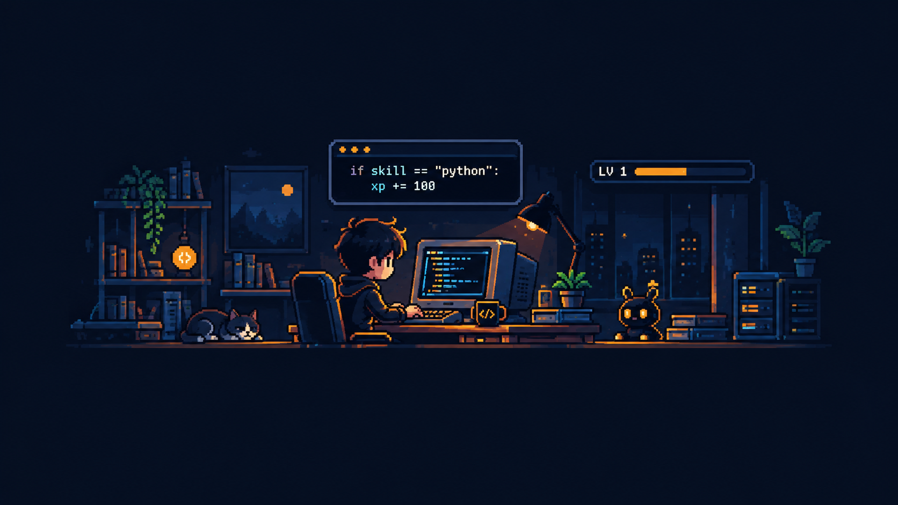
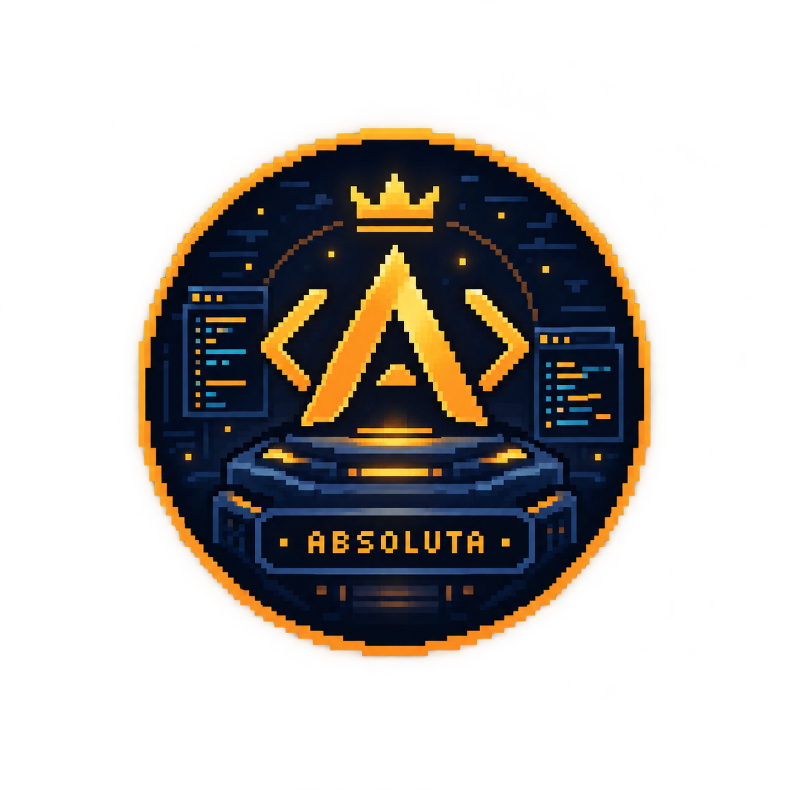

<strong>I build software that turns real workflows into clear, reliable systems.</strong>

Backend & APIs&nbsp; · &nbsp;Business software&nbsp; · &nbsp;Automation&nbsp; · &nbsp;Security-minded engineering

  
  
  
  

  <a href="#selected-work">Selected work</a> &nbsp;·&nbsp;
  <a href="#visual-showcase">Visual showcase</a> &nbsp;·&nbsp;
  <a href="#toolbox">Toolbox</a> &nbsp;·&nbsp;
  <a href="#what-im-focused-on">Current focus</a> &nbsp;·&nbsp;
  <a href="#contact">Contact</a>

---

## A little about me

I'm a **Systems Analysis and Development student at FATEC**, building toward a career in software development with a backend-first mindset.

I enjoy connecting APIs, relational databases, business rules, interfaces and automation into software people can actually use. I also explore application security because reliability is not just about making a feature work — it is about understanding how it behaves, how it can fail, and how to make that behavior safer.

| BUILD | CONNECT | PROTECT |
|:---:|:---:|:---:|
| APIs & business logic | Data & workflows | Testing & secure-by-design thinking |

## Selected work

A few projects that show the kind of problems I like working on. The images link to the repositories; where a project has a real preview or demonstration, it is included below.

<table>
  <tr>
    <td width="50%" valign="top">
      
      <h3>01 / Lumina Skin</h3>
      
An AI-assisted skincare analysis and product recommendation platform. One design principle guides the backend: <strong>AI interprets; the API decides.</strong> Recommendations stay grounded in explicit, testable rules.

      
PYTHON · FASTAPI · PYDANTIC · SQLITE · REACT · TYPESCRIPT

      

    </td>
    <td width="50%" valign="top">
      
      <h3>02 / Estoque Flex</h3>
      
A multi-company inventory system built around traceable stock movements, configurable item fields and role-aware access. Its modular backend separates core inventory rules from customization and authorization.

      
PYTHON · FASTAPI · POSTGRESQL · SQLALCHEMY · REACT · PYTEST

      

    </td>
  </tr>
  <tr>
    <td width="50%" valign="top">
      
      <h3>03 / LeadFlow Agent</h3>
      
A local-first lead research and sales workflow that investigates businesses, checks evidence and organizes qualification and follow-up. It prefers an unresolved field over attaching information to the wrong business.

      
PYTHON · FASTAPI · REACT · AI PROVIDER INTEGRATIONS

      
 

      
Graphic above is a process illustration, not a screenshot of the application.

    </td>
    <td width="50%" valign="top">
      
      <h3>04 / Sol Bravo Energy</h3>
      
A fictional energy-drink brand experience built around interactive 3D product scenes, scroll-driven storytelling and a hands-on product explorer.

      
HTML · CSS · JAVASCRIPT · THREE.JS · WEBGL

      
 

    </td>
  </tr>
</table>

## Visual showcase

A few more glimpses from projects where a visual preview helps tell the story. **Select an image to open its repository.** Animated previews play inline where supported by GitHub.

<table>
  <tr>
    <td width="50%" valign="top">
      
      
<strong>HR Analytics Dashboard</strong> People indicators · DAX · Power BI

      
<a href="https://github.com/GabrielJalmeida/dashboard-powerbi-rh">View project ↗</a>

    </td>
    <td width="50%" valign="top">
      
      
<strong>Weather Forecast Dashboard</strong> REST API · WeatherAPI · Power BI

      
<a href="https://github.com/GabrielJalmeida/dashboard-previsao-tempo-powerbi">View project ↗</a>

    </td>
  </tr>
  <tr>
    <td width="50%" valign="top">
      
      
<strong>Sales Dashboard</strong> Excel · Business reporting · Data analysis

      
<a href="https://github.com/GabrielJalmeida/dashboard-excel-vendas">View project ↗</a>

    </td>
    <td width="50%" valign="top">
      
      
<strong>Product Registration Automation</strong> Python · PyAutoGUI · Pandas

      
<a href="https://github.com/GabrielJalmeida/automacao-cadastro-produtos-python">View project ↗</a>

    </td>
  </tr>
</table>

  
<strong>More projects — business apps, cybersecurity and data</strong>

   
  <table>
    <tr>
      <td width="34%" valign="top">
        <strong><a href="https://github.com/GabrielJalmeida/bella-napoli">Bella Napoli</a></strong> 
        Ordering system concept for a pizzeria, with WhatsApp-oriented automation and AI-assisted workflows.  
        FASTAPI · REACT · POSTGRESQL · DOCKER
      </td>
      <td width="33%" valign="top">
        <strong><a href="https://github.com/GabrielJalmeida/cyber.vulnerable-login-lab">Cyber Lab — Vulnerable Login Lab</a></strong> 
        Educational authentication and service-auditing exercises in an isolated virtual lab.  
        FLASK · PYTEST · KALI LINUX · MEDUSA
      </td>
      <td width="33%" valign="top">
        <strong><a href="https://github.com/GabrielJalmeida/tratamento-dados-excel">Data Cleaning with Excel</a></strong> 
        Preparing and cleaning raw datasets for clearer analysis and reporting.  
        EXCEL · DATA PREPARATION
      </td>
    </tr>
  </table>

## Security lab

  

**Cyber Lab — Vulnerable Login Lab** is an intentionally vulnerable, educational project for understanding authentication behavior and controlled FTP/SMB auditing inside an isolated virtual network. I use the lab to learn how to document evidence, identify weak controls and compare vulnerable behavior with defensive design.

> [!CAUTION]
> This project is intentionally vulnerable and must only be run in an isolated environment against systems you own or are explicitly authorized to test. The `hardened/` directory is only a starter structure; it is **not** a completed or secure implementation.

## Toolbox

  

| Area | Tools I use across projects |
|---|---|
| **Backend & APIs** | Python, FastAPI, Flask, Pydantic, REST APIs |
| **Frontend** | React, TypeScript, JavaScript, Vite, HTML, CSS, Three.js |
| **Databases & data** | PostgreSQL, MySQL, SQLite, SQL, Power BI, Excel, Pandas |
| **Engineering workflow** | Pytest, Git, GitHub Actions, Docker, VS Code |
| **Security labs** | Linux, Kali Linux, VirtualBox, Nmap, Medusa |
| **AI integration** | LLM APIs used as components of explicit application workflows |

## What I'm focused on

  

Right now, I'm strengthening the fundamentals that matter for backend work: **Python, SQL and PostgreSQL, API design, automated testing, object-oriented programming and secure coding**. I keep building across the stack so I can understand how data models, business rules and user-facing behavior fit together.

  
<strong>A longer-term experiment: Absoluta</strong>

   
  
  

  **Absoluta** is an early-stage programming-language experiment exploring intention-driven programming, automation and native AI integration. It's still taking shape, so I'll share more when the ideas are ready to be explained clearly.

## Contact

I'm open to **software development internship opportunities**, especially those involving backend development, APIs, databases and practical business systems. I'm also happy to connect with people building useful things and learning in public.

  

Build with purpose. Learn by doing. Improve what matters.

